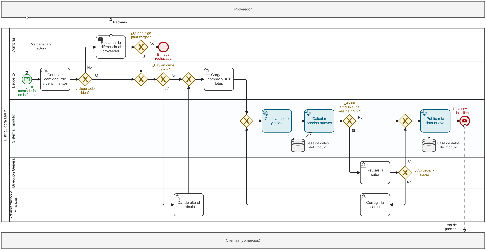

# Módulo de Gestión de Inventario y Costeo Dinámico · Distribuidora Marini

**Trabajo Práctico Integrador y Progresivo (TPI)** · Organización Empresarial
Tecnicatura Universitaria en Programación a Distancia · Universidad Tecnológica Nacional (UTN) · 2026

## Descripción del sistema

Distribuidora Marini es una PyME de Claypole, en la zona sur del Gran Buenos Aires. Vende lácteos, fiambres, aderezos y descartables por mayor y por menor.

El **Módulo de Gestión de Inventario y Costeo Dinámico** ordena el circuito de compras de la empresa. Tiene cuatro funciones:

- **Recibir compras con su costo:** Depósito carga cada factura una sola vez, con sus lotes y vencimientos.
- **Controlar el stock por lote:** el stock de cada artículo es la suma de lo disponible en sus lotes.
- **Recalcular precios:** cuando cambia el costo, el módulo calcula los precios nuevos con el margen de cada lista.
- **Mostrar indicadores:** un tablero avisa el stock bajo, los vencimientos cercanos y el estado de los controles.

## Integrante

| Nombre | Rol en el proyecto | GitHub |
|---|---|---|
| Yazmin Dana Rodriguez | Analista y líder del proyecto | [@YazzRood](https://github.com/YazzRood) |

Comisión 7 · Docente titular: Prof. Gabriela Martínez · Docente adjunta: Prof. Noemi Andrea Ramos · Tutor: Pablo García

## Enlaces

- **Tablero del proyecto (GitHub Projects):** https://github.com/users/YazzRood/projects/1
- **Modelo BPMN:** [docs/bpmn](docs/bpmn)
- **Diccionario de datos:** [docs/datos/diccionario-de-datos.md](docs/datos/diccionario-de-datos.md)
- **Historias de usuario:** [docs/historias-de-usuario.md](docs/historias-de-usuario.md)
- **Indicadores de control:** [docs/control/indicadores.md](docs/control/indicadores.md)
- **Entregas en PDF:** [docs/entregas](docs/entregas)

## Proceso modelado (BPMN)

El módulo transforma el proceso de **recepción de compras, costeo y actualización de precios**. El modelo usa tres pools (Proveedor, Distribuidora Marini y Clientes) y cinco lanes: Compras, Depósito, Sistema (módulo), Dirección General, y Administración y Finanzas.



El archivo editable es [`proceso-compra-costeo-precios.bpmn`](docs/bpmn/proceso-compra-costeo-precios.bpmn) y se abre en https://demo.bpmn.io. La guía de lectura está en [docs/bpmn](docs/bpmn).

## Historias de usuario

| ID | Historia (formato formal) |
|---|---|
| HU-01 | **Como** encargado de Depósito, **quiero** cargar cada compra con sus lotes y vencimientos, **para** tener el stock y el costo al día. |
| HU-02 | **Como** responsable de Administración y Finanzas, **quiero** que los precios se recalculen solos cuando cambia el costo, **para** no vender con precios viejos. |
| HU-03 | **Como** dueño de la distribuidora, **quiero** ver alertas de stock bajo y de vencimientos cercanos, **para** decidir a tiempo qué comprar y qué vender primero. |

Los criterios de aceptación están en [docs/historias-de-usuario.md](docs/historias-de-usuario.md). El estado de cada historia (Por hacer, En progreso o Listo) se sigue en el tablero del proyecto.

## Control del sistema

| ID | Indicador | Estándar |
|---|---|---|
| I1 | Exactitud del stock (M5) | < 2 % |
| I2 | Costo bien calculado | 100 % |
| I3 | Precios al día (M4) | 100 % |
| I4 | Mercadería vencida | ≤ 1 % |
| I5 | Quiebre de stock | ≤ 5 % |
| I6 | Tiempo de respuesta (M2 y M3) | Búsqueda < 1 s y recálculo < 5 s |
| I7 | Disponibilidad del sistema | ≥ 99 % |

Las fórmulas, las fuentes de datos, el semáforo y las acciones correctivas están en [docs/control/indicadores.md](docs/control/indicadores.md).

## Estructura del repositorio

```
tpi-distribuidora-marini/
├── README.md                    → portada del proyecto
├── docs/
│   ├── entregas/                → entregas del TPI en PDF
│   ├── bpmn/                    → modelo BPMN (.bpmn, .svg y .png)
│   ├── datos/                   → diccionario de datos
│   ├── control/                 → indicadores y estándares
│   └── historias-de-usuario.md  → las tres historias y sus criterios
└── .github/
    ├── ISSUE_TEMPLATE/          → plantilla para historias de usuario
    └── pull_request_template.md → lista de control para revisar PR
```

## Cómo trabajamos

- La base del repositorio (README, entregas, datos y plantillas) se subió directo a `main`. Después se protegió la rama: desde ahí, todo cambio entra por un Pull Request (PR) aprobado por un par.
- Cada tema se trabaja en una rama `docs/...`. La lista de control para revisar está en la plantilla del PR.
- Los mensajes de commit siguen el formato `tipo(alcance): qué se hizo`; el alcance es opcional. Por ejemplo: `docs(bpmn): agrega el modelo BPMN del proceso de compra`.
- Las ramas no se borran después del merge, así queda la huella de cada cambio.

## Declaración de Uso de IA

**Herramienta:** Claude (Anthropic), un asistente de inteligencia artificial generativa.

**Para qué la usé:**

- Proponer el modelo BPMN y dibujarlo en notación estándar.
- Redactar este README, las historias de usuario, los indicadores de control y el documento de la Entrega N.º 4.
- Armar las figuras, los textos de las issues, de los Pull Requests y de los commits, y una guía para cargar todo en GitHub.
- Cruzar los indicadores y las historias con mis Entregas N.º 1 y 2, corregir errores de forma de las entregas anteriores y unir las cuatro en el PDF final.

Los datos del caso (las áreas, el circuito de compras y las reglas de costos y precios) salen de mis entregas anteriores. Las cifras de control que no vienen de mis metas de la Entrega N.º 2 (el tope del 15 % para las subas y algunos estándares) son supuestos que propuso la IA: revisé que fueran razonables y coherentes con el resto del trabajo.

### Prompts usados y por qué los escribí así

**Prompt 1**

> Realiza este trabajo N°4 de Organización empresarial. Te paso las consignas, la plantilla y el ultimo [sic] trabajo (N°3) para que te guíes. Usa palabras breves y fáciles que se vea natural.

Junto con el prompt le pasé tres archivos: la consigna de la Entrega N.º 4, la plantilla de la cátedra y mi Entrega N.º 3. Lo hice así para que la IA respetara el caso, el organigrama y el diccionario de datos que ya tenía, y no inventara una empresa nueva. Pedí palabras simples para que el trabajo se lea fácil.

**Prompt 2**

> te paso las entregas 1 y 2

La IA había armado los indicadores sin conocer mis metas. Le pasé las dos entregas para que el control quedara atado a lo que ya había planificado y para unir las cuatro entregas en el PDF final.

**Prompt 3**

> revisa que todo este correcto [...] y decime que tengo que entregar exactamente

Antes de entregar, pedí una revisión final con la lista «Antes de entregar» de la cátedra. Aparecieron errores de forma en las Entregas N.º 1 a 3, que se corrigieron antes de unir el PDF final.

**Mirada crítica:** el primer prompt fue muy amplio. Dejó en manos de la IA decisiones que me tocan a mí, como qué proceso modelar, el tope del 15 % o los valores de los estándares. Una IA puede proponer cifras que suenan bien pero no tienen respaldo: como al principio no le pasé las Entregas N.º 1 y 2, propuso estándares sin conocer mis metas, y uno chocaba con la M4. Por eso no tomé sus cifras como datos. Las que no salen de mis metas quedan como supuestos, a confirmar con las primeras mediciones. Para la próxima conviene pedir por partes, una consigna por vez, y pasar todas las entregas anteriores desde el principio.

### Controles y correcciones humanas

- Revisé que las lanes del BPMN fueran las áreas del organigrama de la Entrega N.º 3 y que cada dato del proceso exista en el diccionario de datos.
- Abrí el archivo `.bpmn` en bpmn.io para comprobar que el modelo se abre y se puede editar.
- Até los indicadores a mis metas de la Entrega N.º 2: I1 controla la M5, I3 la M4 e I6 la M2.
- Corregí un criterio de HU-02: la IA había puesto «un día hábil» y mi meta M4 pide el mismo día.
- Revisé que las cifras que propuso la IA (el tope del 15 % y los demás estándares) fueran razonables y coherentes entre sí.
- Revisé que las historias salieran de las funciones del módulo de la Entrega N.º 1 y que sus criterios se puedan comprobar.
- Revisé las correcciones de forma de las Entregas N.º 1 a 3: corchetes de la plantilla, una frase repetida, puntos finales, la numeración de las consignas y un error de tipeo.
- Un compañero revisó cada Pull Request antes de unirlo a `main`, incluidos los criterios de HU-01 y HU-02.

La IA me ayudó a ordenar y a redactar, pero las decisiones finales son mías, igual que la responsabilidad por cualquier error.
